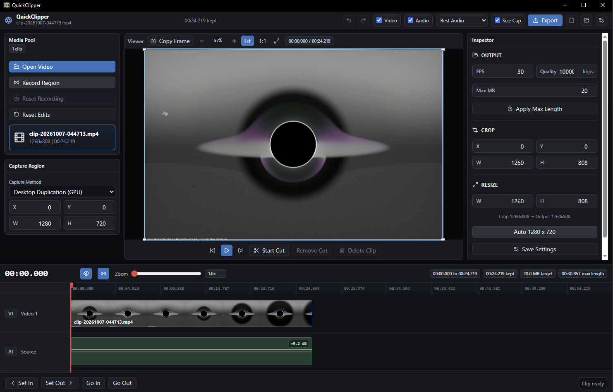

# QuickClipper

QuickClipper is now a Tauri + React desktop clip editor. The old WPF app has been removed from the repo; the Tauri app at the repository root is the default build, release, and update target.



In the viewer, **Copy Frame** pauses playback and copies the current frame to the clipboard as a full-resolution image from the source video. Viewer zoom, crop, and export size do not reduce the screenshot resolution.

While exporting, **Stop Export** cancels the active job and removes its temporary files. It also works for WAV exports, size-cap retries, and encoder benchmarks; completed benchmark files remain available.

Recording uses FFmpeg Desktop Duplication by default to capture GPU-presented windows. The Capture Region panel can switch to the legacy GDI method for comparison. Desktop Duplication requires an FFmpeg build with the `ddagrab` filter and a region contained on one display; QuickClipper reports a clear error if either requirement is not met.

## macOS

QuickClipper also runs on macOS 13 or later, with the same recording, editing and export features. Differences from Windows:

- Recording uses FFmpeg's AVFoundation screen input at the display's full Retina resolution, so a 400x225 region records as 800x450 on a 2x display. The region has to fit on one display.
- System audio is captured with ScreenCaptureKit, with no virtual audio driver needed.
- macOS asks for **Screen & System Audio Recording** permission the first time you record. Allow QuickClipper in System Settings > Privacy & Security, then reopen it.
- QuickClipper is a menu-bar app: it has no Dock icon and keeps running in the background, with its hotkeys, when you close its window or press Cmd+Q. To exit, choose **Quit** from its menu-bar icon.
- The region selector and the recording timer/border also appear over full-screen apps and games.
- Exports can use the VideoToolbox H.264/H.265 hardware encoders instead of NVENC.
- The default hotkeys are Control+Shift+R and Control+Shift+4, because Cmd+Shift+4 is the system screenshot shortcut.
- Install FFmpeg with `brew install ffmpeg`. QuickClipper finds it in `/opt/homebrew/bin` or `/usr/local/bin` even when started from Finder or at login.

Building needs Xcode or the Xcode Command Line Tools, because the ScreenCaptureKit bridge is compiled from Swift. `npm run tauri build` produces `QuickClipper.app` and a `.dmg` in `src-tauri/target/release/bundle/`.

## Local development

```powershell
npm ci
npm run tauri dev
```

## Build

```powershell
npm run build
npm run tauri build
```

Installer output:

```text
src-tauri\target\release\bundle\nsis\QuickClipper_0.1.0_x64-setup.exe
src-tauri\target\release\bundle\msi\QuickClipper_0.1.0_x64_en-US.msi
```

Desktop helper shortcut:

```text
C:\Users\David\Desktop\Build Install Launch QuickClipper.lnk
```

The shortcut runs `scripts\BuildInstallLaunch.ps1`, builds the Tauri app, writes `latest.json`, opens the bundle folder, runs the installer, and launches QuickClipper.

## GitHub releases and updates

The release workflow builds signed Tauri installers and publishes updater artifacts to GitHub Releases. Configure these GitHub secrets:

```powershell
TAURI_SIGNING_PRIVATE_KEY
TAURI_SIGNING_PRIVATE_KEY_PASSWORD
```

Create a tag like `v0.1.0` or run the `Release` workflow manually. The workflow uploads NSIS/MSI installers, signatures, and `latest.json`.

Existing Tauri installs can auto-update from:

```text
https://github.com/daveranan/clipper/releases/latest/download/latest.json
```

Existing WPF/Velopack installs will not auto-update from Tauri's `latest.json`. Those users need a one-time WPF/Velopack bridge release that launches the new Tauri installer, or they need to install the new Tauri build manually once.
